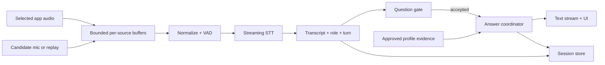

# Architecture and interfaces

See requirements §4–11 for complete contracts and data semantics. Initial scaffold: `ConversationCore` SwiftPM target (only source-role gate). Expand into SPM targets as implementation warrants; the project layout in §13.1 is guidance, not a mandate to create empty targets. The native macOS app and Xcode project are M00 tasks.

## Dependency direction

`AppShell -> SessionCoordinator -> AudioCapture/AudioPipeline -> SpeechToText -> ConversationCore -> QuestionDetection -> AnswerCore -> ProviderCore`. KnowledgeCore supplies evidence to AnswerCore; SessionStore receives normalized events through a persistence boundary; ReviewCore consumes stored sessions. Keep protocol contracts in domain targets to avoid cycles. TestSupport supplies fake time, fake sources and transport; portable modules must never import AppKit/SwiftUI/CoreAudio. AudioCapture and app composition are Mac-only adapters.

## Lifecycle invariants

Session ID + capture epoch + source ID + provider item ID + logical turn ID establish ownership. Capture epoch changes on pause/resume or reconnect where appropriate; stale events must not modify the active session. A question ID is created once per accepted logical turn; an answer revision guards competing generation tasks. Candidate/unknown auto-trigger suppression precedes classification and is checked again before publishing. A user manual generate action is explicitly separate. Intentional repeated questions have new logical turns. Independent capture and generation tasks share bounded, typed events; stop releases resources before acknowledgement and disables late updates.

## Data boundary

Persist only data enabled by explicit retention settings; local-only raw audio buffering by default. SQLite migrations are transactional. Keep approved facts separate from documents and from job requirements. Context is bounded by relevance and token budget; untrusted input cannot alter system behavior. Provider secrets from Keychain only at runtime; environment variables, if used for opt-in development smoke tests, never printed. Transcript debug logs off by default. Use synthetic content for committed fixtures.

## macOS and cloud boundary

Linux cloud builds portable Swift targets only. Native SwiftUI/AppKit and Core Audio require macOS SDK/Xcode. A macOS hosted CI runner can compile and test noninteractive UI-independent paths but is not equivalent to a physical Mac with a live selected application, mic permissions and real devices. Record compile-only versus real-device evidence separately. Do not substitute simulated audio for production capture.
